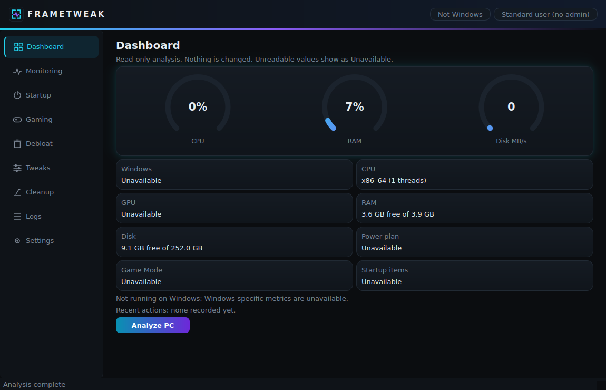
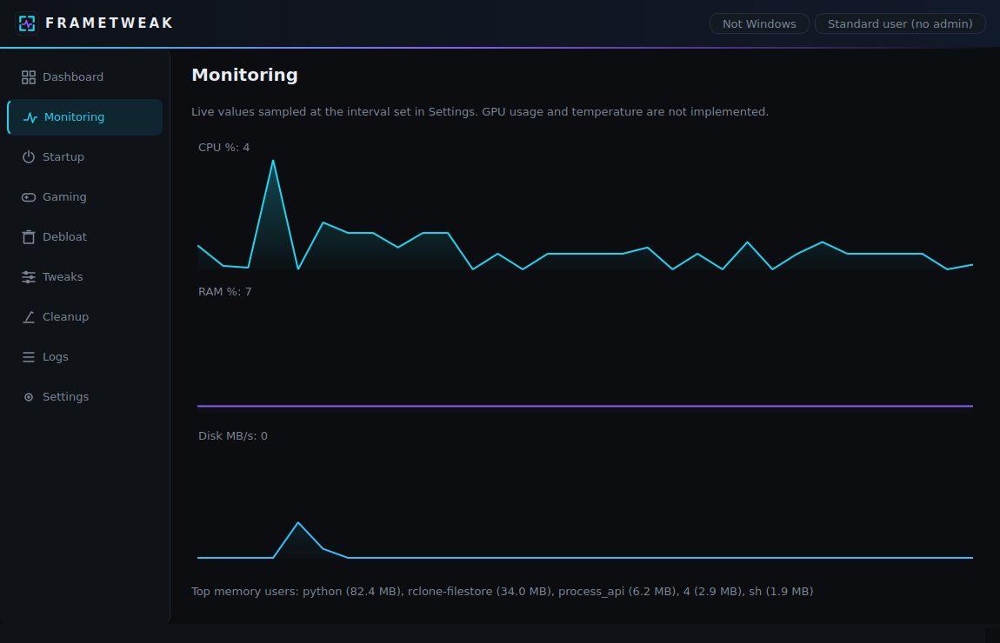
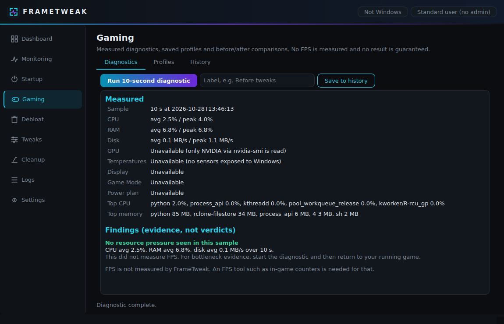
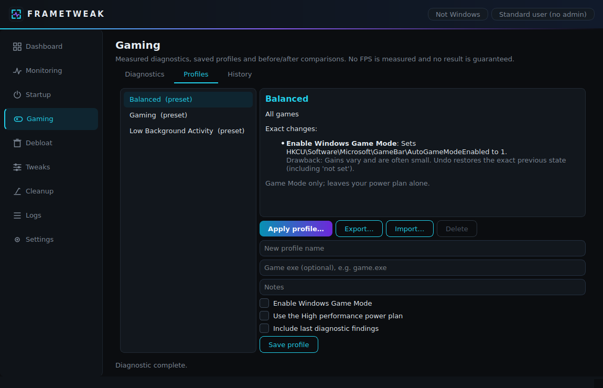
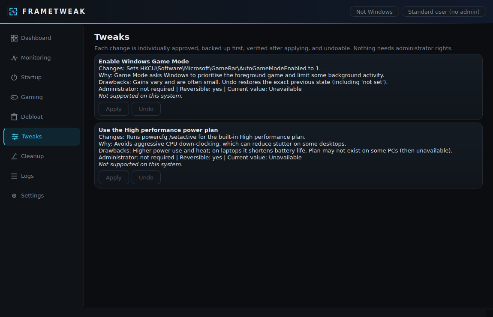
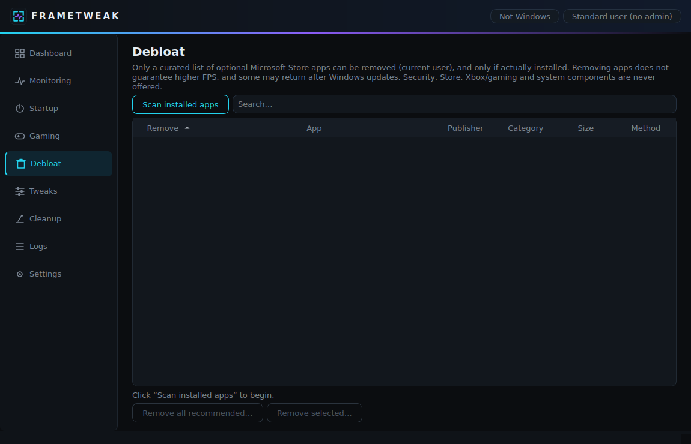
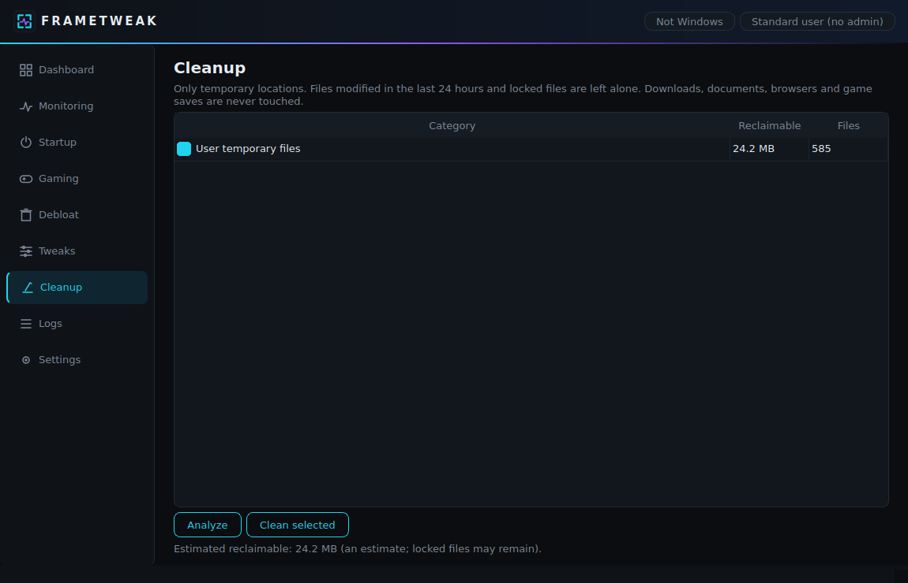

# FrameTweak

**A transparent, reversible Windows 10/11 gaming optimizer and debloater.** Every change is explained before it happens, individually approved, backed up, verified afterwards, and undoable. FrameTweak measures your PC honestly: it never invents FPS numbers, temperatures or "boost" percentages.

> **Status: alpha.** Built and unit-tested on Linux. The Windows-specific code (registry, `powercfg`, Store-app removal, installer scripts) has **not yet been run on a real Windows PC**. See [Verification status](#verification-status). Use at your own risk and read each confirmation dialog.

## Screenshots

> Captured headlessly on a non-Windows machine, so Windows-only fields (edition, GPU, power plan, Game Mode, startup count) correctly read **Unavailable**. On Windows they show real values. Regenerate with `python tools/screenshots.py`.

| Dashboard | Monitoring |
|---|---|
|  |  |
| **Gaming: diagnostics** | **Gaming: profiles** |
|  |  |
| **Tweaks** | **Debloat** |
|  |  |
| **Cleanup** | |
|  | |

## What it does

| Area | What you get |
|---|---|
| **Dashboard** | Live CPU/RAM/disk gauges; Windows version, CPU, GPU, RAM, disk, power plan, Game Mode, startup count; recent actions. Unreadable values show "Unavailable". |
| **Monitoring** | Live CPU, RAM and disk charts and top memory users. Samples only while the page is visible. |
| **Gaming** | 10-second measured diagnostic (CPU/RAM/disk, top processes, display resolution and refresh rate, NVIDIA GPU via `nvidia-smi`, sensors when exposed). Findings cite their evidence and avoid definitive "bottleneck" claims. Profiles (3 presets + custom, validated JSON import/export). History with before/after comparison. **No FPS is measured.** |
| **Startup** | Lists Run-key and Startup-folder entries with status. Enable/disable through `StartupApproved` (what Task Manager uses): backed up, verified, undoable. Nothing is deleted. |
| **Debloat** | Detects installed Store apps and offers removal of a **curated allow-list only** (23 optional Microsoft apps such as Weather, News, Solitaire, Clipchamp, Copilot). Security, Store, Xbox/gaming and system components are blocked. One confirmation lists exactly what will be removed; each removal is verified. Removal is not auto-reversible (reinstall from the Microsoft Store). |
| **Tweaks** | Game Mode and the High performance power plan, each with what/why/drawbacks/admin/reversible/current value. |
| **Cleanup** | User temp files and crash dumps only. Analyze first, then confirm. Skips files modified in the last 24 h and locked files, never follows symlinks, refuses protected folders. Reports measured bytes removed. |
| **Logs / Settings** | Local log viewer; persisted monitoring interval and window size. |

### Safety principles
- **Analyze first, change nothing** until you approve.
- **One shared engine** for every change: read → back up → apply → re-read to verify → roll back on failure → log. If a backup fails, nothing changes.
- **No security features are touched**: Defender, Windows Update, firewall, drivers and recovery are out of scope.
- **No wildcard deletion, no downloaded scripts, no shell strings.** All subprocesses go through `src/core/winproc.py` (argument lists, `CREATE_NO_WINDOW`, timeouts), and a test forbids starting subprocesses anywhere else.
- **Imported profiles are data**, validated against a strict schema and never executed.
- **Local-first**: no account, no telemetry, no network needed after installation.
- **Honest limits**: Microsoft Edge is deliberately *not* removable (it provides WebView2, which other apps depend on, and Windows has no supported removal path).

## Install (Windows 10/11)

1. Download/extract the project.
2. Double-click **`Install-FrameTweak.bat`**. No admin needed; internet is needed once for dependencies. It checks Windows and Python 3.10+ (64-bit), creates a project-local `.venv`, installs `requirements.txt`, verifies the install, and creates a **FrameTweak** desktop shortcut that launches the app directly (no console window).
3. Start FrameTweak from the desktop shortcut.

Other scripts: `Launch-FrameTweak.bat` (manual launch), `Uninstall-FrameTweak.bat` (removes the shortcut and optionally `.venv`/build output; keeps `%APPDATA%\FrameTweak` settings, logs and backups unless you choose to delete them), `Build-FrameTweak.bat`.

**From source:**
```
py -3.12 -m venv .venv
.venv\Scripts\activate
pip install -r requirements.txt
python main.py
```

## Build a standalone .exe
`Build-FrameTweak.bat` runs the tests, then builds `dist\FrameTweak\FrameTweak.exe` with PyInstaller (`FrameTweak.spec`, windowed, with icon) and, if Inno Setup 6 is installed, `dist-installer\FrameTweak-Setup.exe`. If the exe exists, the installer script uses it and Python is not needed.
No Windows PC? Push to GitHub and run the **build-windows-installer** workflow; it attaches the installer as a downloadable artifact.

## Architecture
```
main.py                  entry point (start-up errors -> native message box + log)
src/core/                sysinfo, winproc (the only subprocess launcher), applog, paths
src/tweaks/              engine.py (backup/apply/verify/rollback/undo) + catalog.py
src/startup/             inspect_startup.py, manage.py
src/debloat/             appx.py (curated allow-list, deny patterns, verified removal)
src/cleanup/             cleaner.py (allow-listed roots, age gate, symlink-safe)
src/gaming/              diagnostics.py (measurements + evidence-based findings)
src/profiles/            store.py (validated profiles, history, comparison)
src/backup/              store.py (atomic JSON backups)
src/monitoring/          live.py (psutil sampling)
src/ui/                  PySide6 pages; worker.py runs blocking work off the UI thread
tests/  tools/  assets/  installer/  .github/workflows/
```

## Testing
```
pip install -r requirements-dev.txt
python -m pytest -q
```
46 tests cover system-info fallbacks, backup/restore, the change engine (including failed writes, failed verification, corrupt backups), startup toggling against a fake registry, debloat classification and refusals, cleanup safety, profile validation/import/export, diagnostics analysis, subprocess hygiene, icon assets, the background worker, window smoke tests, and static checks of the `.bat` scripts. Destructive operations are always mocked; tests never touch real system settings.

### Verification status
| | Status |
|---|---|
| Unit and headless UI tests | Run: 46 passed (Linux) |
| Registry, `powercfg`, `Get/Remove-AppxPackage`, display API, `nvidia-smi` | Written, mocked in tests, **not run on Windows** |
| `.bat` installer/launcher/uninstaller/build scripts | Statically checked only, **not run on Windows** |
| PyInstaller exe, Inno Setup installer, desktop shortcut, "no console window" behavior | **Not built or run** |

Safe manual check on Windows: apply Game Mode from Tweaks and undo it, confirming in Settings → Gaming; disable and restore one startup entry and confirm in Task Manager → Startup; remove a harmless app like Weather and confirm it is gone.

## Known limitations
- Windows 10/11 only (other versions are flagged unsupported).
- Only two tweaks so far (Game Mode, High performance plan). Presets are therefore similar.
- GPU stats need NVIDIA + `nvidia-smi`; AMD/Intel show Unavailable. CPU temperature is usually not exposed by Windows.
- No FPS measurement; that needs an external tool and is out of scope.
- Changing all-users (HKLM) startup entries requires running FrameTweak as administrator.
- Cleanup scan runs on the UI thread; large temp folders may briefly pause the window.
- Unsigned installer: SmartScreen may warn.

## Roadmap
Privacy and visual-effects tweaks; Edge startup/background behavior tweaks; AMD/Intel GPU sensors; light theme; code signing; optional external FPS-tool integration (opt-in).

## Disclaimer
FrameTweak changes Windows settings and can uninstall apps. It is provided as-is, without warranty. Create a restore point and read each confirmation. It does not guarantee any FPS improvement.

## License
MIT (see `LICENSE`).
